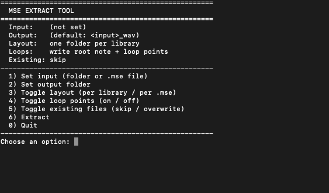

# MSE Extract Tool

A small, dependency-free Python script that extracts the WAV samples stored inside `.mse` instrument files. It works on single files or on whole folders, recursively.

Made by **muR Lab**.

Also available with a graphical interface at [murlab.com/mse-extract](https://murlab.com/mse-extract).

> **Work in progress:** development is still ongoing. The file format was reverse-engineered from sample files and not every variant has been tested yet, so expect changes. Feedback and issues are welcome.

> **Only for testing purposes:** use it to check that your `.mse` files were packed correctly, or to recover the samples from your own old `.mse` libraries.
> Use it only on files you created or have a license for, and respect the license (EULA) of every sample library. Most of them do **not** allow redistributing or reselling the samples.

## Features

- Batch extraction of whole folders, including subfolders
- One output folder per library (e.g. `Sample Bank.instruments` -> `Sample Bank/`), with the WAVs directly inside
- Samples shared by several `.mse` files are written once; different samples with the same name get a `(2)` suffix
- Every output is a WAV, also for samples whose source was a `.flac`
- Interactive numbered menu in the terminal, or plain command-line arguments
- Lossless output: the audio is copied byte for byte, with no re-encoding
- Keeps root note and loop points in the WAV (`smpl` chunk), so samplers that support it recognise them
- Detects and skips duplicate references to the same sample
- No dependencies: Python 3.8+ standard library only

## Usage

### Interactive menu

```bash
python3 mse_extract.py
```



On macOS you can drag a folder into the terminal when the script asks for a path.

### Command line

```bash
# whole folder (recursive); output goes to MyLibrary_wav next to it
python3 mse_extract.py MyLibrary

# custom output folder
python3 mse_extract.py MyLibrary -o ~/Desktop/extracted

# several files or folders at once
python3 mse_extract.py lib1 lib2 "My Instrument.mse"
```

| Option | Description |
|---|---|
| `-o`, `--output` | Output folder (default: `<input>_wav` next to the input) |
| `--per-mse` | One subfolder per `.mse` instead of one folder per library |
| `--no-loops` | Don't write root note and loop points |
| `--overwrite` | Overwrite WAVs that already exist |

## File format notes

Each sample embedded in a `.mse` file is stored as:

```
<original path>\0       (.wav or .flac: FLAC sources are stored decoded)
uint32  bytes per sample
uint32  sample rate
uint32  channels
uint32  unknown (0 or a library-specific value, doesn't affect the layout)
uint64  frame count
<interleaved little-endian PCM: frames * channels * bytes>
<zone data: root note, loop mode, start/end, loop start/end, ...>
```

The audio is stored uncompressed and is not encrypted. Sample rates are not limited to the standard ones (e.g. 31244 Hz for K2000-era samples).

The tool was tested on 16-bit mono and stereo files at many sample rates (17-96 kHz). Other bit depths are handled but untested. If a file doesn't extract correctly, please open an issue. Describe the file, but don't attach copyrighted material.

## Disclaimer

This project is not affiliated with, endorsed by, or connected to any sample library developer or `.mse` instrument maker. All trademarks belong to their respective owners.

This software is provided "as is", without warranty of any kind. You are solely responsible for how you use it and for complying with the licenses of the content you process.

## License

MIT, see [`LICENSE`](LICENSE). You are free to use, modify and redistribute the script, including in commercial projects.

The **muR Lab** name is not covered by the license.

© 2026 muR Lab
